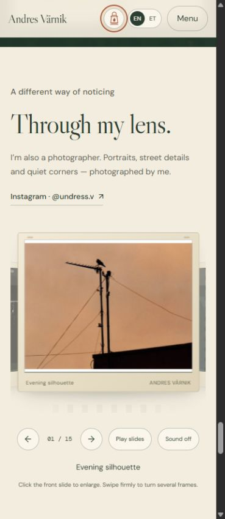

# Andres Värnik — A curious mind

A personal portfolio about how I investigate technical problems, explain them clearly, and make things outside work.

The site combines a scroll-driven SQL and API investigation with warm paper colours, pixel-art illustrations, small physics experiments and my own photography. It is built with HTML, CSS and vanilla JavaScript. The finished portfolio is a single file that can be opened offline or attached to an application.

**[Open the portfolio](https://sonechkammr.github.io/andres-varnik-portfolio/)** · [Development story](docs/DEVELOPMENT.md) · [Technical notes](docs/ARCHITECTURE.md) · [Validation](docs/VALIDATION.md)

The live portfolio is publicly available through GitHub Pages. You can also download this repository and open `index.html` offline. External destinations such as Instagram, Telegram and the Android release still need an internet connection.

## What you can explore

| Part | What it does |
| --- | --- |
| A technical investigation | An order table follows the scroll, becomes a SQL query, connects to an API error and ends with a verified resolution. All order data is fictional. |
| Two visual modes | The lantern switches between the warm paper design and its darker, illustrated counterpart. |
| English and Estonian | English is the default. The header switches the portfolio text and interactive labels to Estonian. The preference is stored locally when the browser allows it. |
| Three visual explanations | Change wave interference, balance a lever and explore how light bends in water. These are simplified teaching illustrations. |
| Experience and skills | Technical support, SQL and API diagnostics, logs, reproductions, developer escalations and mentoring. |
| Personal projects | Mind Garden, a Buddhist-inspired Android app for meditation, journaling and daily check-ins; a Practice Wheel; singing in three bands; and my writing channel. |
| Photography | Fifteen of my photographs in a shuffled slide-projector deck. Cards turn edge-on, retreat into depth and bring the next frame forward. |
| Hidden arcade | Two monochrome jumps reveal a larger platformer, a top-down lantern arena and a perspective finale with a secret music door. Three hearts, optional synthesized music and no story captions. |

### The photography projector

An ordinary transition takes **1.4 seconds**. Acceleration, depth, shading and a very small settling movement give the frames a mechanical feel. A firm swipe advances several photographs, with the last frame slowing to a stop. Sound is optional and starts off; it is synthesized locally with the Web Audio API.

The gallery also supports previous/next buttons, arrow keys, an optional slideshow and a larger photo viewer. It shuffles once on each page load, then keeps that order while you browse.



## Run it

**No setup:** download the repository and open `index.html` in a current browser. Fonts, pictures, the English CV and the Practice Wheel are embedded in that file. The [release notes](docs/RELEASE_NOTES.md) describe the first packaged version.

**Edit and rebuild:** install Node.js 20 or newer, then run these commands from the repository root. There are no npm dependencies to install.

```sh
npm run build
npm run check
npm start
```

Open `http://127.0.0.1:4173`. Stop the server with `Ctrl+C`. To use a different port, set the `PORT` environment variable.

## Repository map

```text
index.html                 Ready-to-open, self-contained portfolio
src/index.template.html    Editable page structure
src/styles/                Base, lantern, controls, gallery and fallback styles
src/scripts/               Main interactions, theme/language controls and projector
src/translations.et.json   English-to-Estonian text dictionary
assets/                    Photographs, illustrations, fonts, CV and Practice Wheel
scripts/                   Dependency-free build, validation and local server
docs/                      Development decisions, architecture and validation notes
```

Edit `src/` and rebuild. `index.html` is generated and committed so visitors can use the portfolio immediately. [Architecture](docs/ARCHITECTURE.md) explains the asset markers and how to replace pictures.

## How it was made

I directed the concept, content, visual references and interaction requirements. Development used AI assistance for implementation, prototyping and iteration. I reviewed the results and asked for specific changes: warmer colours, stronger continuity during scrolling, personal pixel-art imagery and more convincing mechanical motion.

This repository records the completed implementation and a retrospective of that process. It does not present reconstructed stages as separate historical commits. See [Development story](docs/DEVELOPMENT.md).

## About me

I am a technical support engineer based in Tallinn. I enjoy following evidence through a problem and helping someone understand the next step. Outside work, I take photographs, sing and write about Buddhist practice.

- [Instagram — @undress.v](https://www.instagram.com/undress.v/)
- [Telegram — @undressbuddhism](https://t.me/undressbuddhism) — in Russian
- [Mind Garden — Android test release](https://github.com/sonechkammr/vibesvibesvibes/releases/tag/mind-garden-v0.0.5-android-test)

Project documentation and the default portfolio interface are in English. The optional Estonian interface, Russian text inside original project screenshots and the linked Russian Practice Wheel are retained intentionally.

## Credits and reuse

My photographs and personal material are included to present my work. Pixel-art illustrations were created with AI assistance using the supplied character and visual references. Third-party font licenses and asset notes are in [CREDITS.md](CREDITS.md). Publication of this repository does not grant a blanket license to reuse its code, personal photographs or artwork.
